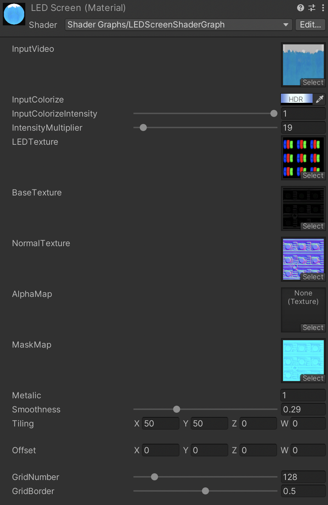
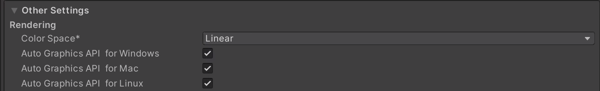

# LEDScreenShader

**LEDScreenShader is a native HLSL shader for rendering realistic LED panels in Unity.** 
**LEDScreenShaderはUnity上で高品質なLEDパネル表現を行うネイティブHLSLシェーダーです。** 

The current version replaces the previous Shader Graph implementation with a native shader (`llcheesell/LEDScreen`). It is designed for HDRP and URP, with a simplified Built-in Render Pipeline fallback shader included for compatibility only.

現在のバージョンでは、従来のShader Graph実装からネイティブシェーダー（`llcheesell/LEDScreen`）へ移行しています。主な対応対象はHDRP / URPです。Built-in Render Pipeline向けには簡易的なFallbackシェーダーを同梱していますが、公式サポート対象外です。

## Render Pipeline Support

* **HDRP** — Supported and tested.
* **URP** — Supported and tested.
* **Built-in Render Pipeline** — A simplified fallback shader is included, but Built-in is not officially supported or actively verified.

HDRP / URPではUnity 2021およびUnity 6000.3.15で動作確認しています。Built-in Render Pipelineは未検証のため、サポート対象外として扱います。

## Features

* **Native HLSL Shader** — Uses a single main shader instead of separate Shader Graph assets for each render pipeline.
* **Subpixel RGB Separation** — LED texture RGB channels act as per-subpixel masks, reproducing red, green, and blue LED elements.
* **Procedural LED Patterns** — Includes procedural LED layouts such as stripe, grid, and honeycomb.
* **HDR Brightness Control** — Intensity Multiplier is suitable for high-luminance HDRP/URP scenes.
* **Screen-Space LED Fade** — Reduces moire by fading LED detail according to screen-space LED density.
* **DDX/DDY Auto-Fade** — Uses screen-space coverage to automatically reduce excessive LED detail.
* **Cabinet Grid** — Renders panel cabinet seams with configurable width, depth, and per-cabinet brightness variation.
* **Motion Vectors** — Provides camera motion vector support for TAA ghosting reduction in HDRP/URP.

## Samples

* HDR brightness control

* Includes multiple LED panel textures

* LED fade for moire reduction

## Usage

1. Create a new material and set the shader to `llcheesell/LEDScreen`.
2. Set the texture or RenderTexture to **Input Screen Texture**.
3. Select an LED texture or procedural LED pattern.
4. Adjust **Intensity Multiplier** based on the scene exposure and bloom settings.

## Offline Documentation

The Asset Store package includes **Documentation/LEDScreenShader_Start_Guide.pdf**. It contains a numbered English start guide, setup steps, shader property reference, migration notes, troubleshooting, and a Japanese quick guide.

## Migration

Version 2.0 replaces the previous Shader Graph implementation with the native shader `llcheesell/LEDScreen`.

If legacy Shader Graph materials are found, LEDScreenShader shows a migration prompt in the Unity Editor. You can also run the migration manually from **Tools > LEDScreenShader > Migrate Legacy Materials to Native Shader**.

The migration tool detects materials that still reference the previous Shader Graph shaders, including materials that appear as Missing Shader after updating from the GitHub package. The old input/video texture is assigned to **Input Screen Texture** (`_InputTex`). Compatible LED textures, LED tiling, input texture tiling/offset, emission color, and intensity are copied to the native shader where possible.

Version 2.0では、従来のShader Graph実装からネイティブシェーダー`llcheesell/LEDScreen`へ移行しています。

旧Shader Graphを参照しているマテリアルが見つかった場合、Unity Editor上で移行プロンプトが表示されます。手動で実行する場合は **Tools > LEDScreenShader > Migrate Legacy Materials to Native Shader** を使用してください。

GitHubパッケージの更新後にMissing Shaderになったマテリアルも、既知の旧Shader GUIDから検出して移行できます。旧Input/Videoテクスチャは **Input Screen Texture**（`_InputTex`）に割り当てます。互換性のあるLEDテクスチャ、LEDタイリング、Input TextureのTiling/Offset、Emission Color、Intensityは可能な範囲で引き継ぎます。

## Main Properties

**Input**

* **Input Texture** (`_InputTex`) — The texture or RenderTexture shown on the panel. 
パネルに表示するテクスチャ、またはRenderTextureを指定します。
* **Input Tiling/Offset** (`_InputTex_ST`) — Tiling and offset for the input texture.

**Surface Options**

* **Surface Type** (`_LEDSurfaceType`) — `Opaque` (default, previous behavior) or `Transparent`. 
不透明（従来動作）か透過かを選択します。
* **Blend Mode** (`_LEDBlendMode`) — `Alpha` (alpha blending) or `Additive` (additive blending; black is transparent). 
透過時の合成方法。Alpha はアルファブレンド、Additive は加算合成です。
* **Alpha Source** (`_LEDAlphaSource`) — `None` (Opacity only), `Input Texture Alpha` (alpha channel of the Input Texture), or `Alpha Map`. 
アルファの取得元。映像入力のAチャンネル、または独自のアルファマップを使用できます。
* **Alpha Map** (`_LEDAlphaMap`, `_LEDAlphaMapChannel`, `_LEDAlphaMapUseInputUV`) — Custom alpha texture, the channel to read (R/G/B/A), and whether it follows the Input Texture tiling/offset. 
アルファマップのテクスチャ、読み取るチャンネル、Input Textureと同じTiling/Offsetに追従するかを指定します。
* **Invert Alpha / Opacity** (`_LEDAlphaInvert`, `_LEDOpacity`) — Inverts the alpha source and multiplies the final alpha.
* Blend state, render queue, and depth/shadow/motion-vector passes are configured automatically by the material inspector. Transparent materials do not write depth, cast shadows, or output motion vectors. 
ブレンドステート、Render Queue、深度/影/モーションベクターパスはマテリアルインスペクターが自動設定します。透過時は深度書き込み・影・モーションベクターを出力しません。

**LED**

* **LED Texture** (`_LEDTex`) — RGB subpixel mask texture. R/G/B channels define which subpixel areas light up. 
LEDの発光パターンを指定します。R/G/Bチャンネルがそれぞれサブピクセルのマスクとして機能します。
* **Procedural LED** — Generates LED layouts procedurally without a texture. 
テクスチャを使わず、シェーダー内でLED配列を生成します。
* **LED Columns / Rows** (`_LEDTilingX`, `_LEDTilingY`) — Number of LED tiles in X/Y. 
LEDパターンの横方向/縦方向のタイリング数を設定します。

**Brightness**

* **Intensity Multiplier** (`_IntensityMultiplier`) — Emission intensity for HDR lighting and bloom workflows.

**LED Fade**

* **Fade Start / End** (`_FadeStart`, `_FadeEnd`) — Screen-space density range where LED detail fades to reduce moire. 
画面上のLED密度に応じてLEDディテールをフェードし、モアレを抑制します。
* **Fade Bias** (`_FadeBias`) — Fade curve exponent (`<1` = early blend, `>1` = delayed blend) while LED detail is faded.

**Cabinet Grid**

* **Cabinet Grid Enabled** (`_CabinetGridEnabled`) — Toggles cabinet seam rendering.
* **Cabinet Columns / Rows** (`_CabinetColumns`, `_CabinetRows`) — Number of cabinet modules in X/Y.
* **Cabinet Seam Width/Depth** — Controls seam width and indentation strength.
* **Cabinet Brightness Variance** — Adds subtle luminance variation per cabinet.

**Base Material**

* **Base Texture / Normal Map / Mask Map** (`_BaseMap`, `_NormalMap`, `_MaskMap`) — PBR surface properties. MaskMap channels: R=Metallic, G=AO, A=Smoothness. 
パネル本体のベースマテリアルを設定します。

## Notes

* Linear Color Space is recommended. Gamma Color Space can clamp bright areas more easily. 
リニアカラースペースでの使用を推奨します。

* Bloom post-processing is recommended for realistic LED brightness. 
リアルなLED発光表現にはBloomポストエフェクトの併用を推奨します。

* Built-in Render Pipeline is not officially supported. The included fallback shader is intended only as a simplified compatibility path. 
Built-in Render Pipelineは公式サポート対象外です。同梱のFallbackシェーダーは簡易互換用として扱ってください。

* The previous Shader Graph implementation is not included in the main package. The supported shader is `llcheesell/LEDScreen`. 
旧Shader Graph実装はメインパッケージには含めていません。現在のサポート対象は`llcheesell/LEDScreen`です。

## License

Under [MIT License](LICENSE) 
*Credit, or notice of use is not required but much appreciated!*
